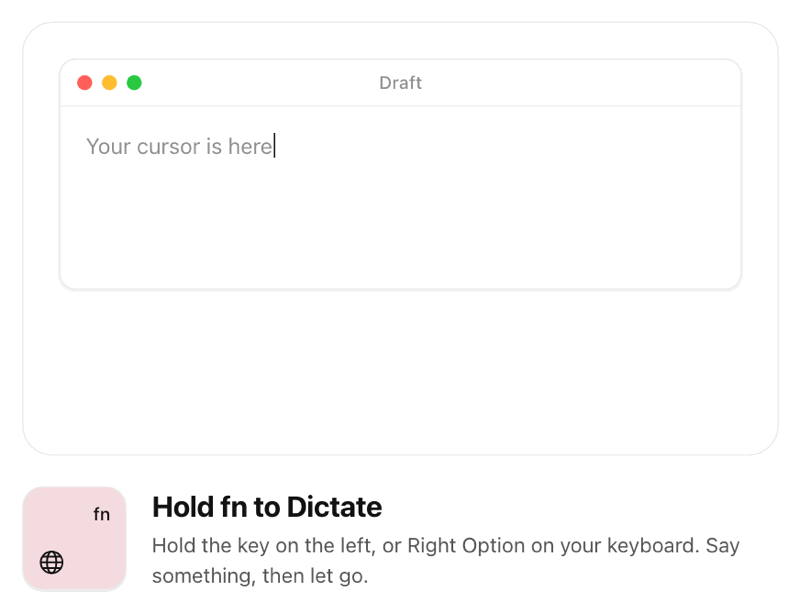
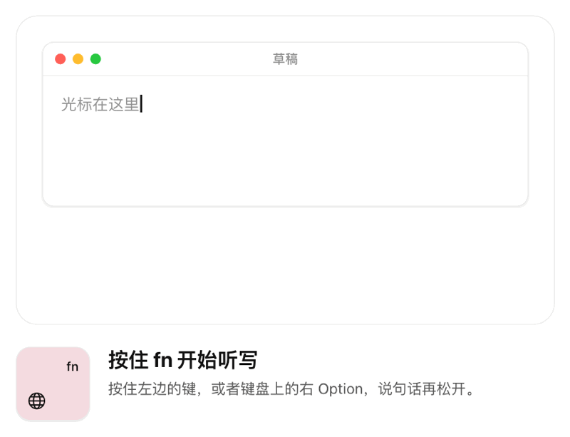

# Kay

Kay is an open-source push-to-talk dictation app for macOS. Hold **fn** and speak. Let go, and the text appears
where your cursor is, in any app.

It streams your voice to
[Qwen Audio 3.1 ASR](https://help.aliyun.com/zh/model-studio/qwen-audio-3-1-asr-flash-streaming)
(Alibaba Cloud) or Doubao Streaming ASR 2.0 (Volcengine), whichever you pick, while you hold the key and
pastes the finalized text when you release it. It uses **your own API key**: there is no Kay server, and no
subscription.

<a href="https://max1874.com/kay/"></a>

<sub>A recorded demo from [max1874.com/kay](https://max1874.com/kay/), where you can try it yourself.</sub>

[中文说明](#中文说明)

## Install

1. Download `Kay-x.y.z.dmg` from [Releases](https://github.com/max1874/kay/releases) and drag Kay to Applications.
   It is signed and notarized. Requires **macOS 26** on Apple silicon. From 1.5.0 on Kay updates itself
   (Sparkle): it checks once a day, downloads in the background and installs while you're not dictating.
2. Open Kay and allow **Microphone** and **Accessibility** (to notice the key and paste for you).
3. In **Settings → Speech Service**, pick a service under **Dictate With** and add its API key (see below),
   then hold fn and talk.

### Getting an Alibaba Cloud key

1. Open [Alibaba Cloud Model Studio](https://bailian.console.aliyun.com/) and create an API key.
2. In **Settings → Speech Service**, enter the key and the URL for the same workspace, such as
   `https://<WorkspaceId>.cn-beijing.maas.aliyuncs.com`. Beijing and Singapore keys use different
   workspaces and endpoints. The default `https://dashscope.aliyuncs.com` is the legacy Beijing endpoint.
3. Press **Test & Save**. Kay starts a task with the same model and WebSocket as dictation, verifies
   access without sending microphone audio, then saves the key in the Keychain.

Kay uses `qwen-audio-3.1-asr-flash-streaming`. Pricing is Alibaba Cloud's and is based on input/output
Token usage; see [current rates](https://help.aliyun.com/zh/model-studio/qwen-audio-3-1-asr-flash-streaming).

### Getting a Volcengine (Doubao) key

1. In the [Volcengine console](https://console.volcengine.com/speech/new/setting/apikeys) (new console), enable
   Doubao Streaming ASR 2.0 and create an API key.
2. In **Settings → Speech Service**, pick **Volcengine Doubao ASR**, enter the key and choose the resource you
   bought (hourly or concurrent), then press **Test & Save**. Kay opens the dictation WebSocket to check it.

### Switching

Each service keeps its own key in the Keychain; a key is only ever sent to its own service. Switch with
**Dictate With** in Settings or the menu next to the microphone menu in Kay's window; the next press uses the
new one. A service picked before it has a key becomes the one Kay dictates with once its key passes the test.
Each dictation in History records which service recognized it (`engine`).

### Eval

`tools/eval.py` sends eval recordings (kept privately, not in this repository) through each service the way Kay
does and reports the character error rate against a reference; `tools/label.py` serves a local page for writing
each recording's reference while listening to it. On 22 of Max's recordings (2026-10-11, three runs each) Doubao
averaged 5.6% and Qwen 14.3%. Kay sends no hot words: a list tried in 1.7.1 recovered a few names but pulled
unrelated speech towards its terms, and was removed in 1.8.0. Each dictation in History also records the
microphone it came from (`microphone`).

## How it works

- **Hold to talk.** fn by default. Settings → General → Add Key… records more: any modifier key, left or right,
  alone or together, and holding any key in the list dictates, so each keyboard can use its own (an HHKB's
  Alt next to its Fn, say; the HHKB's own Fn never reaches macOS). Pressing any other key while holding
  cancels, so fn and ⌥ shortcuts keep working.
- **Streaming ASR.** Audio is converted to 16 kHz / 16-bit mono in 200 ms packets. Kay buffers it until
  the task is ready, sends packets in order, then finalizes the task on release. Final sentences are
  collected by sentence ID so partial revisions never duplicate text.
- **Paste.** The text goes through the clipboard and a simulated ⌘V, and the previous clipboard is restored. With
  **Settings → General → Show in Clipboard History** off, the text is marked transient (nspasteboard.org) so
  clipboard history apps such as Raycast leave it out; the restored clipboard is always marked, since it is not a new copy.
  Without Accessibility permission Kay just copies it.
- **Correction.** Before pasting, DeepSeek V4.1 Flash (your own key, **Settings → Correction**) fixes words the
  speech service misheard, such as product names, without rewording; on by default, and a no-op until a key is
  added. On 22 of Max's dictations (2026-10-12) it took Doubao from 5.5% to 3.7–4.8% CER without changing a correct
  word into a wrong one; Qwen models with the same prompt made things worse. It adds about half a second (median
  0.6 s). Kay pastes what it heard when the whole request takes over 3 s, fails, or adds text before or after what was
  said, rewrites or drops more than a little of it, instead of replacing words in place (a reply rather than a
  correction), and for dictations under 4 words or characters. A short dictation replaced by an English word of
  about its length ("Done") still gets through: by counting it looks like a name fix. History
  keeps the recognizer's text in `heard` when correction or the vocabulary changed it.
- **Vocabulary.** **Settings → Correction → Vocabulary** (`vocabulary.txt`, one term per line, `Term | how it gets
  misheard`) puts your spellings back in place, with no model and no key: a term spelled out letter by letter
  ("c f" → CF), with its digits read out next to Chinese ("e to b" → E2B), or one of the aliases you wrote; never
  English words that happen to join into a term ("type switch"). Before DeepSeek and again on its answer. On 595 of
  Max's dictations (2026-10-18) it replaced 5 spans, all of them right. The list goes nowhere else: as hot words it
  pulled unrelated speech towards its terms (1.7.1), and shown to DeepSeek as candidates for what sounded close it
  turned 同意 and 统一 into 通义 and Mac mini into Gemini.
- **Music and videos.** When the sound comes from speakers (the Mac's, a display's, HDMI, AirPlay), Kay pauses what
  is playing once you have held the key for 0.3 s and plays it again when the dictation is over; with Bluetooth
  audio (headphones, and a Bluetooth speaker too, which Core Audio can't tell apart) or the headphone jack it leaves it playing. **Settings → General → Pause Music and Videos** turns it off.
  It reads and commands the system's Now Playing through [mediaremote-adapter](https://github.com/ungive/mediaremote-adapter)
  (`macOS/Vendor`, BSD 3-Clause), run by `/usr/bin/perl`, since macOS 15.4 lets only Apple's own processes use it.
  Kay pauses only what it read as playing and plays only what it paused, so a paused player is never started.
- **History.** Every dictation — and the reason, when one fails — is kept on this Mac in
  `~/Library/Application Support/Kay/history.json` (last 1000). Click one to copy it again.
- **Recent audio.** The last 20 dictations' audio is kept next to it in `recent/<entry id>.wav`, so a
  misrecognition can be played back or sent again (for example with `tools/ab.py`). A dictation cut off by a
  crash or quit is recognized again at the next launch and lands in History. Deleting an entry, or Clear All,
  deletes its audio.
- **Microphone.** The microphone menu under the status line in Kay's window picks the input device; when it isn't connected, Kay records from the
  system default. If that microphone doesn't start within 2 seconds, Kay falls back to the Mac's built-in one.
- **Logs.** `~/Library/Logs/Kay/kay.log` (rotated, about 8 MB in all) records each dictation's microphones,
  timings and outcome, never its text. If Kay's main thread stops answering during a dictation, a snapshot of
  every thread and the last minutes of the system log goes to `~/Library/Logs/Kay/hangs/<time>/`.

### Privacy

Your keys are stored in the macOS Keychain. Audio goes directly from your Mac to the service you picked:
the Alibaba Cloud workspace you configure (`*.maas.aliyuncs.com` or `dashscope.aliyuncs.com`) or Volcengine
(`openspeech.bytedance.com`). Recent audio stays on this Mac except when
you explicitly send it again for recognition. With a DeepSeek key added, the recognized text (not the audio) goes
to `api.deepseek.com` for correction.

## FAQ

**How is Kay different from the Dictation built into macOS?** macOS Dictation is built in and needs no key. Kay
records for exactly as long as you hold the key and pastes when you let go; recognition is done by the service you
pick (Qwen or Doubao) on your own account; DeepSeek can fix misheard names before pasting; and every dictation is
kept in a searchable History on your Mac.

**Which speech recognition does it use, and what does it cost?** `qwen-audio-3.1-asr-flash-streaming` (Alibaba Cloud
Model Studio) or Doubao Streaming ASR 2.0 (Volcengine). Kay is free; the service bills you directly at its standard
rates (Alibaba Cloud by input/output tokens, Volcengine by the hourly or concurrent resource you bought). DeepSeek
correction is optional and billed by DeepSeek.

**Where does my audio go?** Only to the speech service you picked. Kay records while you hold the key; a dictation
cut off by a crash or quit is sent again at the next launch. There is no Kay server. See [Privacy](#privacy).

**Will Gatekeeper block it?** No. Releases are signed with a Developer ID and notarized. Kay runs on Apple silicon
only.

**How do I uninstall it?** Remove each key in Settings (Remove Key…), quit Kay and move it to the Trash, then delete
`~/Library/Application Support/Kay`, `~/Library/Logs/Kay` and `~/Library/Preferences/com.max1874.kay.plist`, and
remove Kay under Microphone and Accessibility in System Settings → Privacy & Security.

More at [max1874.com/kay](https://max1874.com/kay/).

## Build from source

```
macOS/    the Mac app (SwiftPM; Package.swift is at the root), its resources and scripts
iOS/      an experimental iPhone app (Xcode project) — not maintained, not on the App Store
Shared/   compiled into both: the Qwen and Doubao streaming protocols, audio capture, key storage, history
```

Needs Xcode 26 (macOS 26 SDK).

### About the iPhone app

`iOS/` is an experiment that stopped on purpose. It dictates from a Control (Action Button, Control Center,
Lock Screen) through an `AudioRecordingIntent`, with a Live Activity while it listens, and it works — but iOS
lets only a keyboard type into another app, and keeps the clipboard from an app in the background (tested on
iOS 27, 2026-09-30). So the text only reaches the clipboard when Kay is in front, or through a Shortcut that
copies the action's result, and every dictation ends in a manual paste. Against the built-in dictation, or a
keyboard such as Doubao's own, that was not worth it. Kept for reference; build it with Xcode 27.

```sh
make app      # build/Kay.app — signed with your Developer ID if you have one, ad hoc otherwise
make icon     # regenerate macOS/Resources/AppIcon.icns
make strings  # regenerate the .lproj tables from macOS/scripts/localize.py (English, Simplified Chinese)
```

`make release` / `make install` are the maintainer's notarize-and-publish flow and depend on private tooling
(`asc`); you don't need them to build or run Kay. `make release` notarizes a build, publishes it — the GitHub
release, then the appcast that installed copies update from — and installs it on the maintainer's Mac.

`tools/ab.py` compares Doubao and Qwen ASR on an audio file (latency, text, cost). It reads credentials from a
`.env` file in the repository root, which is git-ignored.

## License

[MIT](LICENSE). `macOS/Vendor/mediaremote-adapter` is BSD 3-Clause, © Jonas van den Berg (its `LICENSE`).

---

## 中文说明

Kay 是一个开源的 macOS 按住说话听写工具。按住 **fn** 说话，松开后文字直接出现在光标处，任何 app 里都可以。

<a href="https://max1874.com/kay/"></a>

<sub>动图录自 [max1874.com/kay](https://max1874.com/kay/)，那里可以亲手试。</sub>

按住期间把语音实时推给阿里云的**千问语音 3.1 流式识别**或火山引擎的
**豆包流式语音识别 2.0**（二选一），松开后将最终文本粘贴到光标处。使用**你自己的 API Key**，没有 Kay 服务器，也没有订阅。

**安装**：从 [Releases](https://github.com/max1874/kay/releases) 下载 DMG 拖进「应用程序」（已签名公证，需要
Apple 芯片的 macOS 26）。1.5.0 起自动更新：每天检查一次，后台下载，不在听写时自动装好。首次打开允许「麦克风」和「辅助功能」，然后在「设置 → 语音服务」里填 Key。

**获取 Key**：在[阿里云百炼控制台](https://bailian.console.aliyun.com/)创建 API Key，
在 Kay 中填写 Key 和同一工作空间的地址，例如 `https://<WorkspaceId>.cn-beijing.maas.aliyuncs.com`。
点「测试并保存」后，Kay 会先验证该工作空间的千问模型访问权限，通过后才将密钥保存到钥匙串。
费用由阿里云按输入、输出 Token 收取。

**切换服务**：「设置 → 语音服务 → 听写使用」或主窗口麦克风菜单旁的菜单。每个服务的 Key 各自存在钥匙串里，
只发给它自己的服务。总被听错的专名（如 Raycast、Cursor）交给 DeepSeek 纠错：在「设置 → 纠错」填自己的 DeepSeek Key，粘贴前会改正听错的词，不改写句子。被拆成字母的名字（c f、e to b）写进「设置 → 纠错 → 词表」，Kay 会直接改回 CF、E2B；总被听成别的词的，写成 `Cursor | 咳嗽`。词表不需要 Key，也不发给任何服务（热词在 1.8.0 已移除）。豆包 Key 在[火山引擎控制台](https://console.volcengine.com/speech/new/setting/apikeys)（新版）创建，
填好后选资源类型（小时版或并发版）再测试并保存。

**快捷键**：默认 fn。「设置 → 通用 → 添加按键…」可以再录入别的键：任意修饰键，分左右，单独或一起按；按住列表里任何一个都能听写，所以每个键盘可以用各自的键（例如 HHKB 用 Fn 旁边的 Alt；HHKB 自己的 Fn 不会发给 macOS）。按住时再按其他键会取消本次录音，所以 fn 和 ⌥ 组合键照常可用。

**音乐和视频**：声音从扬声器外放时（Mac 自带、显示器、HDMI、AirPlay），按住超过 0.3 秒 Kay 会暂停正在播放的内容，听写结束后接着播放；用蓝牙设备（耳机，也包括蓝牙音箱，系统分不出来）或插耳机孔时照常播放。可在「设置 → 通用 → 暂停音乐和视频」关闭。只暂停读到正在播放的内容，只恢复自己暂停的那一个，不会把本来停着的播放器打开。
如果松开 fn 后弹出了表情面板，把「系统设置 → 键盘 → 按下 🌐 键时」设为「不执行任何操作」。

**隐私**：Key 只存在 macOS 钥匙串；音频从你的 Mac 直接发到你选的服务（阿里云或火山引擎），不经过其他地方。填了 DeepSeek Key 时，识别出的文字（不是音频）会发给 DeepSeek 纠错（「设置 → 纠错」，默认开启）。
听写历史只保存在本机，可在「设置 → 通用」里全部清除。

**常见问题**

- **和 macOS 自带的听写有什么不同？** 系统听写是自带的，不需要 Key。Kay 按住键说多久就录多久，松开才粘贴；识别由你选的服务（千问或豆包）在你自己的账号下完成；可以用 DeepSeek 在粘贴前改正听错的专名；每次听写都存在本机可搜索的历史里。
- **用的是哪个语音识别？要花多少钱？** 阿里云百炼的 `qwen-audio-3.1-asr-flash-streaming`，或火山引擎的豆包流式语音识别 2.0。Kay 免费；识别费用由服务商按标准价格直接向你收取（阿里云按输入、输出 Token，豆包按你买的小时版或并发版资源）。DeepSeek 纠错可选，由 DeepSeek 收费。
- **录音会发到哪里？** 只发给你选的语音服务。只在按住快捷键时录音；听写中途 Kay 崩溃或被退出的，下次启动时会重新发送那段音频。没有 Kay 服务器。
- **会被 Gatekeeper 拦住吗？** 不会，发布版用 Developer ID 签名并经过公证。只支持 Apple 芯片。
- **怎么卸载？** 在设置里对每个服务点「移除 Key…」，退出 Kay 并移到废纸篓，再删除 `~/Library/Application Support/Kay`、`~/Library/Logs/Kay` 和 `~/Library/Preferences/com.max1874.kay.plist`，并在「系统设置 → 隐私与安全性」的「麦克风」和「辅助功能」里移除 Kay。

更多见 [max1874.com/kay](https://max1874.com/kay/)。

**iPhone 版**：`iOS/` 是一次主动叫停的实验。用操作按钮 / 控制中心触发录音、灵动岛显示状态，这些都跑通了；
但 iOS 只允许输入法往别的 app 里打字，也不允许后台 app 写剪贴板（iOS 27 实测，2026-09-30），每次都要多一步
手动粘贴，比不上系统自带的听写或豆包输入法，所以不维护、不上架，代码留作参考。
